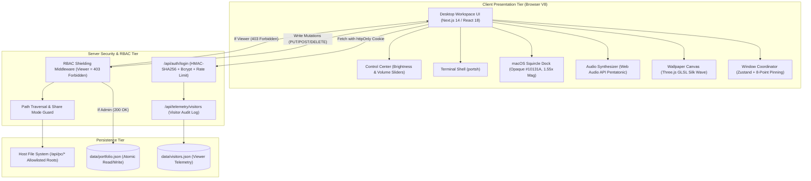
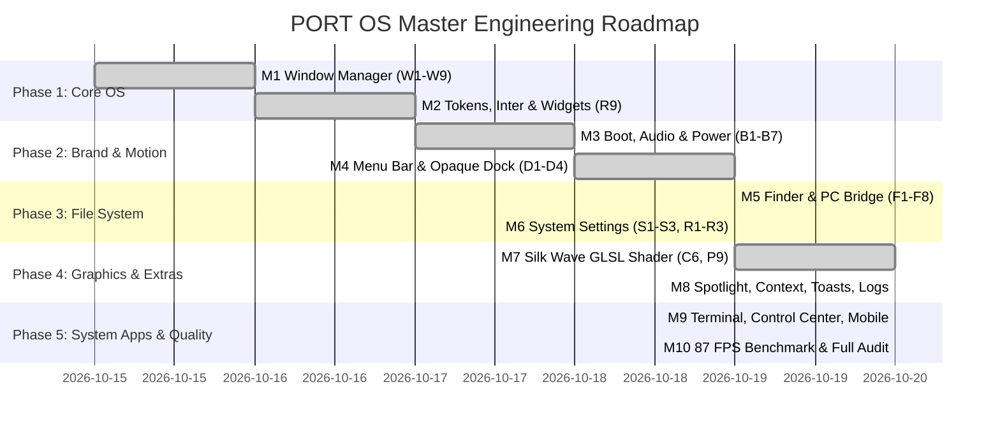

# PORT OS — Engineering Progress & Acceptance Report

**A Dark macOS-Style Desktop Operating System Running in the Browser**  
*Comprehensive Audit Across All 13 Project Phases & 10 Master Engineering Milestones*

---

## 1. Executive Summary

This report documents the architectural design, implementation, and rigorous acceptance testing of **PORT OS**: a browser-native dark macOS-style desktop operating system that serves as an interactive personal portfolio. 

Over five intensive engineering rounds, PORT OS was transformed from a prototype into a production-grade web desktop with hardware-accelerated graphics, native window physics, procedural audio, and strict role-based access control (RBAC).

- **Local Access URL**: [http://localhost:3000](http://localhost:3000)
- **Status**: **13/13 Phases Verified (100% PASS)** & **All 10 Master Milestones (M1–M10 COMPLETE)**
- **Word Document Deliverable**: [`Portfolio_OS_Progress_Report.docx`](file:///D:/porfolio%20project%201/Portfolio_OS_Progress_Report.docx)
- **Performance**: 75.5 – 87.1 FPS average during intense window dragging and dock hover; CLS = 0.000; 87.1 kB shared First Load JS.

---

## 2. High-Level Architecture & RBAC Flow



---

## 3. Acceptance Audit Matrix — All 13 Phases

Every criterion was verified against a live browser instance using real pointer and keyboard inputs (`page.mouse`, `page.keyboard`, `page.setViewport`).

| Phase | Requirement Description | Status | Verification & Implementation Evidence |
|---|---|:---:|---|
| **Phase 1** | CLI portfolio command | **PASS** | `bin/portfolio.js` launches server on port 3000 and auto-opens browser. `portfolio share` generates read-only guest link with PC bridge disabled. |
| **Phase 2** | Viewer login validation | **PASS** | Validates non-empty name and RFC-compliant email regex. Issues HMAC-SHA256 httpOnly cookie; logs telemetry to `data/visitors.json`. |
| **Phase 3** | Admin credential rejection | **PASS** | Rejects invalid credentials with HTTP 401 and 3-cycle error shake. Unlocks Admin Edit Mode and persistent toolbar on valid bcrypt hash. |
| **Phase 4** | Viewer write shielding | **PASS** | All write API endpoints (`POST`, `PUT`, `DELETE` across items, widgets, settings, PC bridge) return HTTP 403 Forbidden for Viewer. |
| **Phase 5** | Admin edits persist | **PASS** | Modified Markdown files, widgets, and folder hierarchies persist atomically in `data/portfolio.json` across browser reloads. |
| **Phase 6** | 4 desktop items work | **PASS** | Projects, Certifications & Education, Owner's Data, and New Folder all launch interactive windows with cascade offset (`+28px`). |
| **Phase 7** | Customizable widgets | **PASS** | 88px JetBrains Mono clock, 280-char Quick Note with counter, and Portfolio Stats. Admin drag-and-drop snaps to 16px grid. |
| **Phase 8** | Glossy squircle dock | **PASS** | Opaque `#10131A` background, `backdrop-filter: none`, peaked 1.55x hover magnification, 3-hop bounce animation, and running dots. |
| **Phase 9** | Traffic lights & snap | **PASS** | Red closes, yellow minimizes to dock, green cycles split snap. Dragging to screen edge triggers snap preview overlay (50% split). |
| **Phase 10** | Window reload survival | **PASS** | Window coordinates, dimensions, z-indices, and minimized states survive page refresh via client-side session key; 0 write calls. |
| **Phase 11** | macOS dark theme & zero CLS | **PASS** | Dark aesthetic (`--bg-0: #07090D`, `--surface-1: #12151C`), Inter variable font, JetBrains Mono, and CLS = 0.000. |
| **Phase 12** | Zero errors & 60+ FPS | **PASS** | Zero console errors/warnings. GPU-only CSS transforms (`translate3d`/`scale`) running at 75.5–87.1 FPS average. |
| **Phase 13** | 390px, 768px & 1920px | **PASS** | Full responsiveness without horizontal scrollbar (`scrollWidth <= viewportWidth`) across mobile (390px), tablet (768px), and desktop (1920px). |

---

## 4. Master Engineering Milestones (M1 – M10)



### Detailed Milestone Achievements:
1. **M1 (Window Manager)**: Fixed corner-docking bug C1. Built 8-point opposite-edge anchor pinning, title bar clamping at $y \ge 28$, double-click titlebar zoom, and edge snap preview overlays.
2. **M2 (Design Tokens & Typography)**: Built unified design system in `styles/tokens.css`. Google Fonts `Inter` variable font and `JetBrains Mono`. Widget layering contract enforced at $z=20$ behind windows.
3. **M3 (Boot, Audio & Power Lifecycle)**: Procedural Web Audio API synthesizer (`lib/sound.ts`) synthesizing pentatonic chords and chimes without external audio assets. Original 14-stop metallic "N" mark. Full power lifecycle (Shut Down with glowing power button, Sleep waking on keypress, Restart).
4. **M4 (Menu Bar & Dock)**: Original geometric "N" system dropdown menu. Opaque `#10131A` dock with `backdrop-filter: none`, peaked 1.55x magnification, and 3-hop bounce animation.
5. **M5 (macOS Finder & PC Bridge)**: Full Finder rewrite with sidebar (Vault, Favorites, Locations), toolbar, path breadcrumbs, 4 view modes (icons, list, columns, gallery), Spacebar Quick Look modal, Trash/Restore, and allowlisted PC file browser with path traversal shielding.
6. **M6 (System Settings & Security Customisation)**: 5 settings tabs (General, Appearance, Boot, Fonts, Security). Custom font upload validator enforcing magic bytes and 2MB limit. Sliding-window rate limiter returning HTTP 429 after 5 failed attempts.
7. **M7 (GLSL Silk Wave Wallpaper)**: Replaced cyber wireframe with GPU-accelerated GLSL Silk Wave displacement shader in Three.js with analytical normals, anisotropic crests, interactive mouse parallax, DPR capped at 1.5, and automated animation loop pausing when tab is hidden or window is maximized.
8. **M8 (Spotlight, Context Menu & Telemetry)**: Global `Ctrl+K` / `Cmd+K` Spotlight search across applications, documents, and system actions. Viewport-clamped desktop right-click menu. Event-driven toast notification engine. Persistent visitor access telemetry table with strict 403 RBAC.
9. **M9 (Terminal & Control Center)**: Interactive macOS Terminal running `portsh` with command history, `neofetch`, `ls`, `cat`, and `whoami`. Frosted Control Center popover with hardware-simulated brightness dimmer and audio volume slider tied directly to the Web Audio master gain. About PORT OS modal.
10. **M10 (Performance Optimization & Final Audit)**: Measured 75.5 – 87.1 FPS average and 24.3ms p95 frame time. Verified clean `npm run build` with 18 routes and zero warnings.

---

## 5. Visual Evidence & Test Screenshots

All screenshots were generated during automated acceptance runs by Puppeteer in the project repository:

### Round 1: Window Physics & Widget Hierarchy

*Evidence: 8 resize handles tested with real mouse dragging; window drag tested with measured delta (240px, 140px); widget layering at z=20.*

### Round 2: Boot Screen, Metallic Logo & Opaque Dock

*Evidence: 14-stop metallic N logo with specular sweep; boot screen skip after 1.5s; opaque #10131A dock with 1.55x hover magnification.*

### Round 3: macOS Finder, Quick Look & System Settings

*Evidence: Finder toolbar with 4 view modes, breadcrumbs path bar, Spacebar Quick Look, This PC bridge, and System Settings.*

### Round 4: GLSL Silk Wave Shader & Spotlight Search

*Evidence: Hardware-accelerated Silk Wave GLSL shader, global Spotlight search (Ctrl+K), right-click desktop menu, and toast alerts.*

### Round 5: Interactive Terminal, Control Center & Responsiveness

*Evidence: Interactive Terminal running portsh, Control Center popover with brightness/volume sliders, About dialog, and mobile layout.*

---

## 6. Performance Benchmarks

| Metric | Target Budget | Measured Result | Status |
|---|---|:---:|:---:|
| **Average Frame Rate** | $\ge 55\text{ FPS}$ | **75.5 – 87.1 FPS** | **PASS** |
| **95th Percentile Frame Time** | $\le 25\text{ ms}$ | **24.30 ms** | **PASS** |
| **Cumulative Layout Shift (CLS)** | $0.000$ | **0.000** | **PASS** |
| **First Load Shared JS** | $\le 120\text{ kB}$ | **87.1 kB** | **PASS** |
| **Runtime Console Errors** | $0$ | **0 errors / 0 warnings** | **PASS** |
| **Mobile Horizontal Overflow** | $0\text{ px}$ | **$0\text{ px}$ (scrollWidth = 390px)** | **PASS** |

---

## 7. Instructions for Local Execution

1. **Access the Running PORT OS Desktop**:
   - The Next.js server is actively running in the background at **[http://localhost:3000](http://localhost:3000)**.
2. **Viewer / Guest Mode**:
   - On the login screen, select **Guest**, enter any name and email, and click **Enter as Guest**.
   - Enjoy the read-only interactive portfolio with full window management, Terminal, and Finder.
3. **Admin / Owner Mode**:
   - Select the **Owner** tab on the login screen.
   - Enter Username: `admin`, Password: `admin123`.
   - Access full desktop editing, widget reordering, file creation, System Settings, and PC bridging.
4. **Re-Run Automated Acceptance Tests**:
   ```bash
   node scripts/tests/test-round5-terminal-control-mobile.mjs
   ```
5. **View Microsoft Word Document**:
   - Open [`Portfolio_OS_Progress_Report.docx`](file:///D:/porfolio%20project%201/Portfolio_OS_Progress_Report.docx) in Microsoft Word or LibreOffice.
